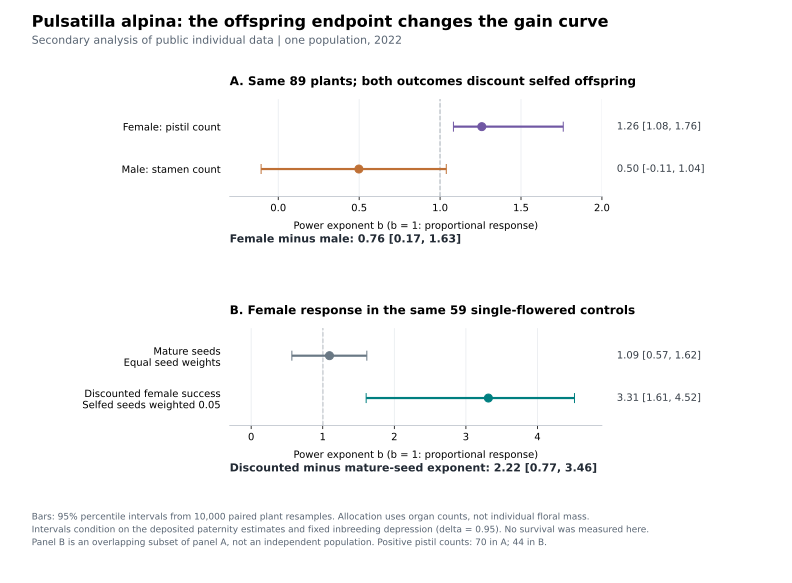

# v0.50｜同じ個体の雌雄利得曲線と、子の評価段階を分ける

> 続報：[v0.51 自殖経路の原データ解析](2026-11-22_selfing_pathway_cross_pollination_v51.md)。Pulsatillaの実際の自殖判定数を調べ、風媒Mercurialisと比較した。本稿の曲線は2025年の保存エンドポイントに条件付けた解析として保持する。2024年公開版の直接判定割合と一部不一致があるため、保存エンドポイントから逆算した値を新しい自殖観測として扱わない。

2026-11-21 JST。前回の掲載値比較から進めて、著者が公開した個体データを取得し、実際に再適合した。**最も明確な新規計算結果は、同じ89個体で雌雄の対応を保っても、Pulsatilla alpina の雌側のべき指数（器官数に対する成功の弾力性）が雄側より大きいこと**である。もう一つの結果は、同じ個体・同じ器官数でも、成熟種子を等価に数えるか、自殖子を近交弱勢で割り引くかによって、母性成功の曲線が変わることである。

これは既刊研究の公開データの二次解析であり、新しい野外実験や独立集団の追加ではない。父性推定値と近交弱勢の係数は著者の推定値に固定している。オニシバリ *Daphne pseudomezereum* の測定結果として扱わない。



## 1. 同一個体の対応を保った雌雄差

Chen & Pannell (2025, *American Naturalist*, [10.1086/737646](https://doi.org/10.1086/737646)) の公開個体表と原著Rコードを照合した。引用されていた概念DOI [10.5281/zenodo.7713765](https://doi.org/10.5281/zenodo.7713765) は有効で、今回固定した版は [Zenodo 15549445, v3](https://zenodo.org/records/15549445) である。

元の135個体から、性配分を操作しておらず、個体サイズと開花日が欠けていない89個体を、著者コードと同じ条件で選択した。除外は操作42個体、非操作だが共変量不完全4個体。89個体中、雌しべ数が正なのは70個体、雄しべ数が正なのは89個体。残り19個体の雌側は器官数・成功とも構造的なゼロであり、花器官を持ちながら繁殖に失敗したゼロとは区別する。

曲線は元の成功尺度での非線形最小二乗 `Y = a X^b`。雌側のXは個体の雌しべ総数、雄側は個体の補正済み雄しべ総数である。`b=1` は比例、`b>1` は比例を上回る増加を意味する。個体別の乾燥重量を測定した解析ではない。

| 推定対象 | 元データからの指数／差 | 95%個体ペア・ブートストラップ区間 |
|---|---:|---:|
| 雌側：雌しべ数 → 補正済み母性成功 | 1.2577 | 1.0826～1.7611 |
| 雄側：雄しべ数 → 補正済み父性成功 | 0.4983 | −0.1058～1.0383 |
| **同じ個体での差 `b_f − b_m`** | **0.7594** | **0.1703～1.6344** |

原著の点推定1.26・0.50を再現した上で、89個体を復元抽出し、毎回同じ個体集合で両曲線を当てはめ直した。10,000回、乱数seed 20261121。掲載された二つの区間を独立とみなして差を検定してはいない。今回の区間は原著の標準誤差に基づく区間とは別の推定である。

雄側だけの区間には1が含まれるため、「雄側が必ず比例未満」とするより、**この標本で雌側のべき指数が雄側より大きいという対応のある差**を中心的な結果とする。1個体ずつ除外した点推定差は0.6473～0.9474で、単一個体の除外では符号は変わらなかった。主要20,000適合の最適化境界到達はゼロ。

この区間は観測された交配ネットワークと推定済み成功を固定した個体再標本化によるもの。共有された母系・父系を含む完全な遺伝的推定誤差、近交弱勢係数の誤差、別年・別集団の変動は含まない。曲線は単変量の観察的関係であり、開花時期や個体サイズを調整した器官増量の因果効果ではない。

## 2. 同じ59個体でも、子の評価段階で曲線が変わる

関連する Chen & Pannell (2025, *Current Biology*, [10.1016/j.cub.2025.04.022](https://doi.org/10.1016/j.cub.2025.04.022)) の [Zenodo 15183584, v2](https://zenodo.org/records/15183584) を追加照合した。この87個体はすべて上記135個体群に一致し、そのうち59個体が上記89個体にも含まれる。59個体はすべて雄しべ除去なしの単花個体で、両表の雌しべ数・雄しべ数は一致した。正の雌しべ数を持つのは44個体である。

Am Nat表は補正済み成功が丸められており、全89個体の未補正成熟種子数は入っていない。そのため、この評価段階比較は、両エンドポイントが保存されている**同じ59個体だけ**で行った。丸め前の補正済み成功とAm Nat表の差は最大0.5子で整合した。89個体全体に59個体の係数を移植しない。

| 59個体における母性成功の定義 | 雌側指数 | 95%ペア区間 |
|---|---:|---:|
| 成熟種子をすべて同じ重みで数える（保存列 `F_RS_ID0`） | 1.0941 | 0.5686～1.6159 |
| 他殖子を1、自殖子を0.05として数える（`F_RS_ID95`） | 3.3139 | 1.6065～4.5167 |
| **補正後 − 補正前の指数差** | **2.2198** | **0.7726～3.4578** |

原著の近交弱勢推定値 `δ=0.95` を固定したため、自殖子の重みは `1−δ=0.05` である。対応する雄側の指数変化は0.2721、区間−0.4510～1.2328で、明確な変化を示さなかった。今回の結果は、母性成功を「何個の種子を作ったか」から「自殖・他殖の来歴を考慮した成功」へ切り替えると、同じ器官数に対する応答の形が変わり得ることを、同じ個体で示す。

ただし、**実際に追跡して生き残った子を数えた結果ではない**。δの操作実験でも、近交弱勢の強さを今回新たに推定した結果でもない。これは原著の保存した季節的成功指標に対する条件付きの感度比較である。繁殖成功と性配分・自殖・近交弱勢を結びつける解釈自体は原著が既に提示しており、今回の追加は59非操作個体での対応を保った指数差と区間の算出である。

同じ10,000抽出の中で四つの曲線を同時に再適合した。未補正雌側の1抽出だけが正の指数の下限に到達したが、独立した格子探索でも上表の指数差の区間を0.0001以内で再現した。別論文だからといってこの集団を二重に数えない。

## 3. ブタクサ：操作区の差と、区内の重量差を分ける

Aljiboury & Friedman (2022, [10.1111/evo.14544](https://doi.org/10.1111/evo.14544)) の [Dryad原データ](https://doi.org/10.5061/dryad.4tmpg4fcp)、公開版178493を取得した。原著の操作は雄花序をつける枝の上限4・8・16・32本を割り付け、除去により維持するもの。測定した雄花序重量は老化開始時に残った乾燥重量で、季節全体の構築・維持コストではない。

### 3.1 公開記録での処理カテゴリ差

| 雄花序枝の上限 | 個体表の全個体数 | 父性成功が明記された個体数 | 明記された父性獲得数の平均 |
|---|---:|---:|---:|
| 4本 | 49 | 47 | 3.936 |
| 8本 | 49 | 49 | 5.449 |
| 16本 | 47 | 47 | 8.383 |
| 32本 | 47 | 45 | 8.756 |

188個体の記録済み成功では、32本区 − 4本区の差は**4.819子／個体**、平均比は**2.224**。別の子表から確認できた2件を欠測1個体に補うと189個体となり、差は4.673。原著の「枝数上限が高い区ほど父性成功が大きい」という方向と整合した。

これは公開記録の未調整平均で、前回掲げた原著の調整済み平均比 `8.05/4.44 = 1.813` とは異なる推定対象である。欠測と遺伝子型の除外を完全には復元できないため、今回の平均差を完全な割付集団の因果効果や総父性適応度と呼ばない。

### 3.2 重量と成功の関連は、区間の差と区内の差で異なる

188個体のゼロを含む父性獲得数に対し、対数リンクのポアソン擬似尤度で平均を当てはめた。いずれもブロックと縁／内部を調整し、二つ目だけ枝数上限のカテゴリも加えた。

| 重量の推定対象 | 対数重量係数 | 個体HC3の95%区間 | 母株家系再標本化の95%区間 |
|---|---:|---:|---:|
| 全処理区を合わせた関連 | 0.2930 | 0.0793～0.5067 | 0.1600～0.4241 |
| 同じ枝数上限内での関連 | −0.2154 | −0.6561～0.2253 | −0.4838～0.0612 |

個体HC3は個体を独立単位とする作業仮定。もう一つは父株集合を固定し、72母株を母株のブロック×処理カテゴリ内で1,999回再標本化した区間であり、母株採集の条件付き変動を示す。両者は別の不確実性を表し、どちらも交配ネットワーク全体・父性割当誤差を完全に覆わない。

**処理区間の正の関連から、同じ処理区内で残存重量が大きい個体の父性成功も必ず増すとは言えない。** 区内係数の区間にはゼロが含まれる。重量が有害、あるいは投資に効果がないと結論するものでもない。189個体・192個体の別定義でも区内係数の区間はゼロを含んだ。これらは原著の負の二項混合モデルや公表べき指数0.85の再現ではなく、処理カテゴリをまたぐ関連と区内関連の区別を目的とした二次診断である。

### 3.3 欠測と掲載値の照合

実ファイルは192個体、72母株、1,242子、177父株。父性獲得数が記録された188個体（うち176個体は正）の合計1,240子は、子表との照合ですべて一致した。個体表の欠測4個体のうち1個体には父性割当2件があり、残り3個体の状態は判別できない。「子表に出ない」を生物学的な成功ゼロへ置き換えない。全192個体の子表登場回数は別の操作的定義としてのみJSONに残した。

Dryadの紹介文「60母株×20子」はファイルと合わず、原著本文の1,257子・176父株とも一部不一致がある。一方、原著の母株あたり17.25子は72株で1,242子となり、公開表の合計と整合する。元解析を完全復元したとは主張しない。

なお、Burd (2026, [10.1002/ece3.73539](https://doi.org/10.1002/ece3.73539)) は原著図のデジタイズに基づく曲線指数0.34と公表指数0.85の相違を既に記している。これは別データの独立実験ではなく、同じ図を再利用した既刊の指摘であり、今回の新発見に数えない。

## 4. オニシバリ研究へ持ち帰る具体的な判断

今回強まった作業仮説は、**花器官への投資と、交配由来・子の生存を経た成功との関係を、雌雄別・段階別に測る価値がある**というもの。Pulsatillaの係数やδをオニシバリへ移植する理由にはならない。

- 雌雄の比較では同じ遺伝的個体の対応を保ち、雄側と雌側を別標本として数えない。性機能が分かれた個体群では、共通の母株集合・父性採集範囲を明示する。
- 花数・器官数・器官別乾燥重量・季節末残存重量を別変数で記録する。原資源量や開花時期の違いから、器官の追加による効果を分離できる設計を優先する。
- 母性側は成熟種子数に加えて自殖／他殖由来、発芽、生存を追跡する。残存雌しべの意義は、結実の有無だけでなく、追加の生存子への寄与で評価する。

既存の野生個体への操作上限（独立ジェネットあたり確認蕾の50%以下かつ10蕾以下、全コホート合算）は維持する。今回、新しい採集・送粉操作は行っていない。

## 5. 再現と検証

計算環境：Python 3.12、NumPy 2.3.5、pandas 2.2.3、SciPy 1.17.0、図はmatplotlib 3.10.8。ソースZIPまたは展開メンバーのSHA-256を固定し、個体ID・座標・親子対応の原行は出力しない。

```bash
python scripts/pulsatilla_paired_gain_refit_v50.py --output data/2026-11-21_pulsatilla_paired_gain_refit_v50.json
python scripts/ambrosia_allocation_refit_v50.py --output data/2026-11-21_ambrosia_allocation_refit_v50.json
python scripts/plot_pulsatilla_gain_curves_v50.py
```

Pulsatillaの元ZIPは既定ではシステム一時ディレクトリへ保存する。既存原本は `--cache-dir` で指定できる。ブタクサはメモリ上で元ZIPを扱い、既存原本は `--input-dir` で指定できる。リポジトリには集計JSON・解析コード・図だけを保存する。

独立検証では別の同時最小二乗法と10,000抽出全体の格子探索でPulsatillaの主要差の区間を0.0001以内に再現し、別の信頼領域法でブタクサの二つの重量係数を再現した。元データの照合、ペア抽出、ゼロの保持、集計出力を確認した。開花日の追加モデルは検討したが、探索時の最適化制約と局所解の問題があり、今回の公開推定・結論には含めていない。

成果物は既存Draft PR #3に追加する。独立研究数を増やすためのレコード追加や異なる指数の統合平均は行わない。
