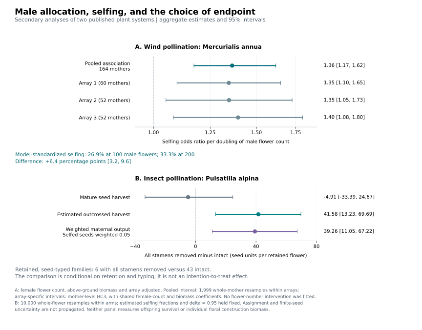

# v0.51｜種子数と交配由来を分ける：虫媒・風媒での自殖経路

2026-11-22 JST。前回の利得曲線比較から進めて、**花器官数・開花時期と、遺伝子判定された自殖種子数との関係**を原データで調べた。今回は風媒の *Mercurialis annua* を加え、*Pulsatilla alpina* と別の実験系に比較を広げた。

主な結果は二つある。**Mercurialis では、雌花数と個体サイズを調整しても、雄花数が多いほど成熟種子の自殖率が高い。Pulsatilla では、種子の採集と遺伝子判定ができた花の間で、雄しべ全除去区と無処理区の成熟種子数に明確な差はなく、推定他殖種子数には正の差がある。** 種子の数量と交配由来を分けると、投資と成功の関係を異なる段階で捉えられる。

どちらも既刊研究の公開データの二次解析であり、新しい野外実験ではない。雄性配分・自殖・近交弱勢を結びつける説明は原著が既に提示している。今回の追加は、推定対象を明示した条件付き関連、同じ家系内の種子数と交配由来の分解、異なる送粉様式での比較である。オニシバリ *Daphne pseudomezereum* 自身の測定結果として扱わない。



## 1. 風媒 Mercurialis：雄花数と自殖の関連は、雌花数・サイズを調整しても残る

原著は Chen & Pannell (2025), *New Phytologist*, [10.1111/nph.70356](https://doi.org/10.1111/nph.70356)。実験進化で雄性機能を発現した二倍体雌系統を用い、3つの実験集団に各61株を配置した。花数の性表現そのものを各株にランダムに割り付けた実験ではない。集団間は150 m以上離されており、集団間花粉移動を減らす設計だったが、絶対に移動しないと検証したわけではない。数えたのは収穫時の全株の雄花・雌花数であり、個体別の花器官乾燥重量や季節全体の花資源投入量ではない。

### 1.1 原著集計の再現と解析対象

[公開データの固定版 Zenodo 15644955](https://zenodo.org/records/15644955) の `Geito_NewPhyto_v2.zip` を取得した。概念DOIは [10.5281/zenodo.14542260](https://doi.org/10.5281/zenodo.14542260)、固定版DOIは [10.5281/zenodo.15644955](https://doi.org/10.5281/zenodo.15644955)。

| 段階 | 株数・種子数 |
|---|---:|
| 設置株 | 183株（61株×3集団） |
| 最終親個体表 | 181株（60・61・60株） |
| 地上部乾燥重量あり | 180株 |
| 父性判定された成熟種子を持つ母株 | 173株、915粒、自殖判定265粒 |
| 重量と父性判定の両方あり | 172株、914粒、自殖判定264粒 |
| **今回のモデル：さらに雌花数・雄花数とも正** | **164株、882粒、自殖判定262粒** |

原著の172母株に対応する母株別自殖率の単純平均は **29.6266%** で、掲載値29.6%を再現した。全種子を一つにまとめた割合とは別の量である。164株への限定では、記録上の雄花数ゼロ7株、雌花数ゼロ1株を除いた。ゼロに微小数を足して対数化していない。したがって、純雌・純雄への外挿には用いない。

9マーカーによる父性推定は原著の保存済み判定を用いる。遺伝子型表には子951行があり、5座以上そろう子948、5座を超える子947。本文の「5座以上」と方法の「5座を超える」の表現差は残るが、解析に使う父性割当合計915は本文と一致する。δ=0/1の適応度表362行は、同じ181株の二つのシナリオであり、362個体ではない。

### 1.2 雄花数の倍増に対応する条件付き関連

母株ごとの「自殖判定数／父性判定数」を応答とする集約二項ロジットモデルを当てはめた。説明変数は `log2(雄花数)`、`log2(雌花数)`、`log2(地上部乾燥重量)`、実験集団別切片。比率である性配分指数を説明変数に使わず、雄花の絶対数と雌花数を分けた。

**雄花数が2倍の株に対応する自殖オッズ比は1.3628、95%母株ブートストラップ区間は1.1729～1.6187。** 各集団内で母株全体を1,999回復元抽出した。種子882粒を独立した882反復とは扱っていない。母株HC3区間は1.1515～1.6129だった。

| 推定対象 | 自殖オッズ比／雄花数2倍 | 95%区間 |
|---|---:|---:|
| 全体：集団内母株ブートストラップ | **1.3628** | **1.1729～1.6187** |
| 実験集団1、60母株 | 1.3453 | 1.0970～1.6497 |
| 実験集団2、52母株 | 1.3464 | 1.0502～1.7262 |
| 実験集団3、52母株 | 1.3951 | 1.0820～1.7987 |

集団別は雄花数係数を集団ごとに変え、雌花数と重量の係数を共通にしたモデルの母株HC3区間。3集団で符号はそろうが、3種・3自然集団の独立研究ではない。母株間の遺伝的近縁、交配ネットワーク全体、父性割当誤差はこの区間に含まれない。

各母株の雌花数・重量・集団をそのまま保持し、雄花数だけ100と200に設定したモデル予測を母株等重みで平均すると、**自殖率26.86% → 33.28%、差+6.42ポイント（95%区間+3.24～+9.60ポイント）**となる。100・200は各集団の雄花数の四分位範囲内だが、それだけで条件付き共変量の十分な重なりを保証するものではない。これはモデル標準化した観察的な差であり、同じ株の雄花を実験的に倍増させた効果ではない。オッズ比1.36を「自殖確率が36%増える」と読まない。

原著は相対性配分に加え、絶対雄花数と自殖の正の関係も報告済みである。今回の追加は、両性の花を実際に記録した株に限り、雌花数・サイズを同時にそろえた絶対数の関連と、その具体的な大きさを示すことにある。

## 2. 虫媒 Pulsatilla：成熟種子数の差と、他殖由来の種子数の差は異なる

原著は Chen & Pannell (2024), *Journal of Ecology*, [10.1111/1365-2745.14378](https://doi.org/10.1111/1365-2745.14378)。[Dryad 10.5061/dryad.hmgqnk9sd](https://doi.org/10.5061/dryad.hmgqnk9sd) の2024年7月16日版CSVを、公式保存コピー [Zenodo 12748590](https://zenodo.org/records/12748590) から取得し、DryadのSHA-256と照合した。

単花・両性花60株には各花の成熟種子数、遺伝子判定した種子数、自殖判定数、雄しべ数、雌しべ数、雌性期開始日がある。原著の操作は開葯前の雄しべ半除去・全除去。主にハエ類が訪れる自家和合性種であり、単花個体では同一株の花間移動による自殖と区別して花内自殖を扱える。ただし、自動的な自家受粉と訪花者による花内自家受粉を別々に推定したものではない。

### 2.1 実際の遺伝子判定数

| 区 | 遺伝子判定と種子収穫がそろう花 | 自殖判定／判定種子 | 種子をまとめた観測割合 |
|---|---:|---:|---:|
| 無処理 | 43 | 265／486 | 54.53% |
| 雄しべ半除去 | 11 | 31／109 | 28.44% |
| 雄しべ全除去 | 6 | 0／49 | 0%（検出なし） |

0/49は採集標本で自殖を検出しなかったことを示す。真の自殖確率が厳密にゼロである証明ではない。上表の割合は種子をまとめた記述量であり、以下の推定他殖収穫数は花ごとの割合を使って計算する。

原著の主要な自殖回帰は判定種子6粒以上の53株、621粒を使っており、この選択を再現できた。今回の無処理だけの関連は、判定数を分母として使える43株すべてに限定した別の推定対象である。

### 2.2 同じ花で、数量と交配由来を分解する

各花の成熟種子数をN、判定標本中の自殖割合をsとすると、推定他殖種子数は `O=N(1−s)`。原著のδ=0.95を固定した母性成功は、他殖子を1、自殖子を0.05で数える `W=N(1−0.95s)` である。**Oは全種子の父性を実測した数ではなく、各花の判定標本から収穫全体へ外挿した推定値**である。Wは実測生存子数ではない。

| 花あたり平均 | 無処理43花 | 半除去11花 | 全除去6花 | 全除去−無処理、95%花ブートストラップ区間 |
|---|---:|---:|---:|---:|
| **成熟種子数 N** | 92.91 | 76.09 | 88.00 | **−4.91［−33.39, +24.67］** |
| **推定他殖種子数 O** | 46.42 | 57.93 | 88.00 | **+41.58［+13.23, +69.69］** |
| δ=0.95で重み付けした母性成功 W | 48.74 | 58.84 | 88.00 | +39.26［+11.05, +67.22］ |

区内で花全体を10,000回再標本化した。観測された花ごとの自殖割合とδは固定しており、少数種子からsを推定した誤差、父性割当誤差、δの誤差、共有交配環境は含めていない。

成熟種子数の区間にはゼロが含まれるため、同等性や「種子生産への効果なし」を示す結果ではない。一方、採集・判定できた花では、推定他殖種子数の差は正である。**雄しべ数と繁殖成功の関係を見る際、種子数だけでは交配由来の違いを捉えられない**ことが、この比較の中心となる。

### 2.3 全割付個体への因果効果とは区別する

2023年の全開花調査表は Chen & Pannell, *Proceedings of the Royal Society B*, [10.1098/rspb.2023.2137](https://doi.org/10.1098/rspb.2023.2137) に対応する [Dryad 10.5061/dryad.rbnzs7hj0](https://doi.org/10.5061/dryad.rbnzs7hj0) の2023年11月13日版である。公式保存コピー [Zenodo 10121671](https://zenodo.org/records/10121671) と、2025年 *Current Biology*, [10.1016/j.cub.2025.04.022](https://doi.org/10.1016/j.cub.2025.04.022) の [Zenodo 15183584](https://zenodo.org/records/15183584) を照合した。

| 単花・両性花の集計段階 | 無処理 | 半除去 | 全除去 |
|---|---:|---:|---:|
| 元の開花調査表 | 54 | 15 | 12 |
| Current Biologyの成熟アウトカム表 | 46 | 12 | 8 |
| 今回使う種子収穫＋遺伝子判定表 | 43 | 11 | 6 |

元の単花調査104株と成熟アウトカム87株のうち、個体IDで正確に対応したのは85株。残る2株の対応を推測で埋めていない。したがって、この表は**集計段階別の標本数の照合**であり、全個体の脱落履歴を完全復元したものではない。今回の処理区差は最終60家系に条件付けた比較で、当初の全割付花に対するintention-to-treat推定ではない。除去によって花粉報酬や訪花行動も変わり得るため、純粋な資源コストや花粉量だけの効果へ限定しない。

### 2.4 自然変異だけでは、雄しべ数より開花時期の関連が明確

無処理43花について、実際の自殖判定数／判定数を集約二項ロジットで解析し、雄しべ数・雌しべ数・雌性期開始日を同時に入れた。

| 変数の変化 | 自殖オッズ比 | 95%花ブートストラップ区間 |
|---|---:|---:|
| 雄しべが50本多い | 1.0584 | 0.5060～1.9327 |
| 雌しべが100本多い | 0.6276 | 0.2947～1.2143 |
| **開花が7日遅い** | **0.5824** | **0.2897～0.9180** |

10,000回すべての適合が収束した。この標本では、器官数をそろえても遅い開花ほど自殖オッズが低い関連が見える。雄しべ数・雌しべ数の区間は広く、自然変異での効果の不在を示してはいない。操作花を含む原著の有意な雄しべ効果と矛盾する結果でもない。

開花時期が自己花粉と他個体花粉の相対量、送粉者の活動、器官の同時成熟などを変える可能性はある。しかし、この回帰でどの経路が原因かは分離できない。暦日の関連を、そのまま他個体花粉の供給量の実測や、開花を遅らせる介入の効果とは読まない。

## 3. 前回から何が進み、何はまだ同じ限界か

[v0.50](2026-11-21_paired_gain_curves_original_data_v50.md) は、同じ個体でも、成熟種子数と自殖子を割り引いた成功で利得曲線が変わることを示した。v0.51では、その評価段階の違いに関係する**実際の自殖判定数**へ戻り、花器官・季節との関連を検討した。Mercurialisを加えたため、比較は虫媒1種内だけではなくなった。

数量と交配由来の区別は、次の恒等式で表せる。

\[
W=N(1-\delta s)=O+(1-\delta)S.
\]

ここでSは推定自殖種子数。Nが同じでも、sとδによってWは異なる。δ=0なら、交配由来をこの式で割り引くことはない。**これは会計上の関係であり、自殖の増加や生存の低下を新たに実証する式ではない。** 実証が必要なリンクは、花器官→交配由来、交配由来→生存、さらにその両側の資源投入と将来繁殖である。

Pulsatillaのδ=0.95は、原著が親と種子の近交係数の差から推定した値であり、今回の同じ子を発芽後まで追った生存率ではない。Mercurialis原著のδ=0/1は仮定したシナリオであり、対象の野生二倍体集団の近交弱勢は未確定と本文に記載されている。今回のMercurialis自殖モデルにはδを一切入れていない。虫媒と風媒の二つの系で、同じ強さの近交弱勢や同じ適応度損失が実測されたとは主張しない。

### 3.1 同一Pulsatilla集団を重複計上せず、保存エンドポイントを混ぜない

2023・2024・2025年のPulsatilla論文は、同じ2022年の集団を共有する。独立研究数を3～4に増やす根拠にはならない。

2024年の60家系の成熟種子数は、対応する2025年Current Biologyの `F_RS_ID0` とすべて一致した。しかし、2025年の二つの保存済みエンドポイントから逆算した自殖割合は、2024年の直接判定割合と最大0.25異なり、δ=0.95の重み付き成功にすると最大18.05の差がある。さらに66両性花の逆算では他殖成分がわずかに負になる例もある。この不一致の原因を丸めだけに確定しない。

v0.50の結果は2025年の保存エンドポイントに条件付けた曲線解析として保持する。今回の交配由来の解析には、**同じ2024年アーカイブの判定分子・分母と成熟種子数だけ**を用いた。別版の逆算値を新しい父性観測に置き換えていない。2024年の二つのCSV間にも1つの個体ラベル差があるが、器官・処理・日付・判定数・形態の組合せで60件すべてが一対一対応することを確認した。IDや原行は公開出力しない。

## 4. オニシバリで検証する予測を絞る

オニシバリについては、[2011年科研費研究成果報告書（20380093、3頁）](https://kaken.nii.ac.jp/file/KAKENHI-PROJECT-20380093/20380093seika.pdf) に自家和合性が低いという報告がある。したがって、自殖経路を種の既定の主要機構と置くことも、「自家和合性の既報がない」とすることも避ける。報告書だけでは、低い自殖成績が花粉受容・花粉管・受精・種子発達のどこで生じるかを確定できない。

| 検証したい予測 | 同じ独立ジェネットでそろえる測定 | 判断につながる結果 |
|---|---|---|
| 雄側への増加が交配由来を変える | 花数・機能的雄しべ・雌しべ、花器官別乾燥重量、成熟種子数、遺伝的自殖／他殖 | 種子数との関連と自殖率との関連を分離できる |
| 開花時期が同じ投資の意味を変える | 雌性・雄性機能の期間、周囲の機能的開花量、自己／他個体由来花粉、父性 | 暦日の差を花粉供給と受容の重なりに結びつけられる |
| 自殖の成立が低い場合、障壁はより前にある | 自家・他家人工受粉、適合花粉管、受精・成熟の段階別成績 | 不和合と受精後の損失を区別できる |
| 交配由来の違いが生存子の違いになる | 同じ種子家系の発芽・幼苗生存、親株の翌年成長・繁殖 | δを他種から移さず、現在成功と将来コストを同時に評価できる |

今回の比較から優先するのは、**花数・重量→成熟種子数だけの関係に、交配由来と生存段階を接続すること**である。真の花構築バイオマスは両再解析とも未測定であり、雄花数・雄しべ数をそのまま投入資源量と同一視しない。野生オニシバリの操作上限は、既存計画どおり独立ジェネットあたり確認蕾の50%以下かつ10蕾以下を全コホート合算で守る。今回、新しい採集や送粉操作は実施していない。

## 5. 再現手順と検証

Python 3.12、NumPy 2.3.5、pandas 2.2.3、SciPy 1.17.0、matplotlib 3.10.8。原ZIP・CSVのSHA-256を固定し、保存済み原本または固定URLから再実行する。Pulsatillaは原ファイルを指定した一時キャッシュへ保存し、MercurialisはZIPをメモリ上で読む。公開成果物は解析コード・集計JSON・図・説明のみである。

```bash
python scripts/mercurialis_selfing_refit_v51.py --output data/2026-11-22_mercurialis_selfing_refit_v51.json
python scripts/pulsatilla_selfing_refit_v51.py --cache-dir /tmp/onishibari-v51-sources --output data/2026-11-22_pulsatilla_selfing_refit_v51.json
python scripts/plot_selfing_pathway_v51.py
```

別実装による独立検証では、Mercurialisの尤度最適化とスコア方程式を再計算し、1,999回の主要係数・標準化差の区間を再現した。Pulsatillaも別のスコア方程式解法で10,000回の無処理内係数と区間、および処理区の平均・差・区間を再現した。数値差はいずれも1e−12未満。根拠のない精度を意味する桁数ではなく、実装照合の一致を示す。通常の科学的解釈には上記の丸めた値と区間を使う。

専用GitHub Actionsは固定原本を再取得し、両解析を実行して保存JSONと比較し、集計図を生成する。既存Draft PR #3に追加し、mainは変更しない。
